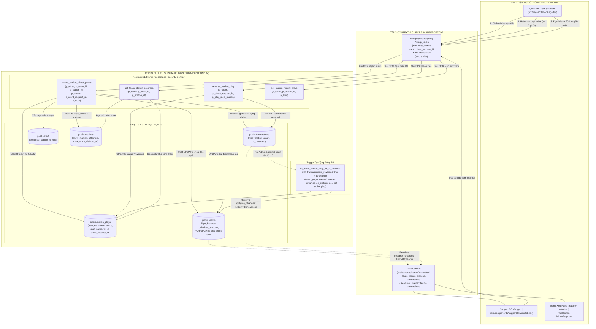

# SYSTEM LOGIC & DEPENDENCY MAP: EVERMYST DIRECT STATION SCORING (MIGRATION 104)

> **Tài liệu Kiến trúc & Bản đồ Logic Rà Soát Tĩnh (Static Code Analysis)**  
> **Cam kết:** Zero-Hallucination Policy — 100% đối chiếu trực tiếp từ mã nguồn thực tế tại `src/` và PostgreSQL Catalog Supabase.  
> **Thời điểm rà soát:** 21/10/2026.

---

## 1. FLOW DIAGRAM (SƠ ĐỒ LUỒNG DỮ LIỆU THỰC TẾ)



---

## 2. MAPPING BẢNG ĐỐI CHIẾU CHI TIẾT (CONTRACT MAPPING)

| Component / File Gọi | Hàm / Tên RPC Client Đang Gọi | Tham Số Client Đang Gửi | RPC / Bảng DB Thật Tương Ứng | Trạng Thái & Nhận Định Kỹ Thuật |
| :--- | :--- | :--- | :--- | :--- |
| `src/contexts/GameContext.tsx` (dòng 562) | `executeStationReward` gọi `submit_station_claim` | `p_station_id`, `p_team_id`, `p_input: { points, unlock_station }` | **Không tồn tại trong DB** (`station_claims` không có) | 🛑 **[LỖI KHÔNG TỒN TẠI: submit_station_claim]**<br/>→ Cần chuyển sang gọi `award_station_direct_points` |
| `src/contexts/GameContext.tsx` (dòng 1285) | `decidePending` gọi `verify_station_claim` | `p_claim_id`, `p_action`, `p_note` | **Không tồn tại trong DB** | 🛑 **[LỖI KHÔNG TỒN TẠI: verify_station_claim]**<br/>→ Cần loại bỏ hoặc thay thế bằng cơ chế hoàn tác `reverse_station_play` |
| `src/contexts/GameContext.tsx` (dòng 276) | Query bảng `team_station_keys` | `select('*')` | **Không tồn tại trong DB** | 🛑 **[LỖI KHÔNG TỒN TẠI: team_station_keys]**<br/>→ Bảng không có trong V1 DB, cần dọn sạch query rác |
| `src/pages/StationPage.tsx` (dòng 121) | `fetchQueue` gọi `get_station_queue` | `p_station_id` | **Không tồn tại trong DB** | 🛑 **[LỖI KHÔNG TỒN TẠI: get_station_queue]**<br/>→ Cần thay bằng `get_station_recent_plays(p_station_id, p_limit)` |
| `src/pages/StationPage.tsx` (dòng 346) | `handleManualSubmit` gọi `submit_station_claim` | `p_station_id`, `p_team_id`, `p_input: manualInput` | **Không tồn tại trong DB** | 🛑 **[LỖI KHÔNG TỒN TẠI: submit_station_claim]**<br/>→ Cần thay bằng `award_station_direct_points(p_team_id, p_station_id, p_points, p_note)` |
| `src/pages/StationPage.tsx` (dòng 242, 276, 312) | Các hàm duyệt gọi `verify_station_claim` | `p_claim_id`, `p_action`, `p_override_points` | **Không tồn tại trong DB** | 🛑 **[LỖI KHÔNG TỒN TẠI: verify_station_claim]**<br/>→ Loại bỏ luồng duyệt hàng đợi claim trung gian |
| `src/components/support/StationTab.tsx` (dòng 69) | `fetchStationStatuses` gọi `get_team_station_status` | Không truyền tham số (chỉ đính kèm `p_token`) | **Không tồn tại trong DB** | 🛑 **[LỖI KHÔNG TỒN TẠI: get_team_station_status]**<br/>→ Cần thay bằng `get_team_station_progress(p_team_id, p_station_id)` (Read-Only) |
| `src/components/support/StationTab.tsx` (dòng 133, 140) | `handleSubmitClaim` gọi `submit_station_claim` / fallback `award_station` | `p_station_id`, `p_team_id`, `p_input` | `submit_station_claim` không tồn tại; `award_station` là V1 cũ | ⚠️ **LỆCH LUỒNG NGHIỆP VỤ**: Support theo đội không được tự bấm chấm trạm cho đội mình. Quản trò trạm tại `/station` mới là người chấm. |
| `src/components/support/StationTab.tsx` (dòng 194) | `handleCancelClaim` gọi `cancel_station_claim` | `p_claim_id` | **Không tồn tại trong DB** | 🛑 **[LỖI KHÔNG TỒN TẠI: cancel_station_claim]** |
| `src/components/admin/PendingAdminQueue.tsx` (dòng 41, 66) | Duyệt claim Admin gọi `verify_station_claim` | `p_claim_id`, `p_action` | **Không tồn tại trong DB** | 🛑 **[LỖI KHÔNG TỒN TẠI: verify_station_claim]** |
| `src/pages/AdminPage.tsx` (dòng 97) | `fetchPendingClaims` gọi `admin_list_claims` | `p_status: 'pending_admin'` | **Không tồn tại trong DB** | 🛑 **[LỖI KHÔNG TỒN TẠI: admin_list_claims]** |
| `src/lib/rpc.ts` (dòng 14-16, 37) | Đăng ký `MUTATION_RPCS` & `IDEMPOTENT_MUTATIONS` | `submit_station_claim`, `verify_station_claim`, `cancel_station_claim` | Các RPC này không tồn tại trong DB | ⚠️ **THIẾU ĐĂNG KÝ**: Chưa khai báo `award_station_direct_points` và `reverse_station_play` vào danh sách Mutations & Idempotency. |
| `src/lib/rpc.ts` | Gọi RPC `award_station_direct_points` | `p_token, p_team_id, p_station_id, p_points, p_client_request_id, p_note` | `public.award_station_direct_points(...)` (Migration 104) |  **KHỚP 100%**: Backend đã cài đặt và test PASS 15/15 ca. Client chỉ cần kết nối hàm gọi. |
| `src/lib/rpc.ts` | Gọi RPC `reverse_station_play` | `p_token, p_client_request_id, p_play_id, p_reason` | `public.reverse_station_play(...)` (Migration 104) |  **KHỚP 100%**: Backend đã sẵn sàng nhận lệnh hoàn tác từ Quản trò & Admin. |
| `src/lib/rpc.ts` | Gọi RPC `get_station_recent_plays` | `p_token, p_station_id, p_limit` | `public.get_station_recent_plays(...)` (Migration 104) |  **KHỚP 100%**: Backend trả về danh sách lịch sử lượt chơi kèm trạng thái active/reversed. |
| `src/lib/rpc.ts` | Gọi RPC `get_team_station_progress` | `p_token, p_team_id, p_station_id` | `public.get_team_station_progress(...)` (Migration 104) |  **KHỚP 100%**: Backend trả về tiến độ chính xác của đội tại từng trạm. |

---

## 3. QUẢN LÝ STATE & REALTIME LOGIC

### 3.1. Các State hiện hữu trong `src/contexts/GameContext.tsx`
1. `teams`: Mảng `Team[]` (id, name, light_balance, unlocked_stations, shield_until, is_active, ...).
2. `stations`: Mảng `Station[]` (id, name, order_index, scoring_type, scoring_config, min_score, max_score, allow_multiple_attempts, ...).
3. `transactions`: Mảng `Transaction[]` (200 giao dịch mới nhất, theo dõi sổ cái biến động điểm).
4. `teamStationKeys`: State cục bộ `Record<string, string[]>` đang query bảng không tồn tại (`team_station_keys`).
5. **THIẾU TRONG STATE TOÀN CỤC**: Chưa có state lưu trữ `stationPlays: StationPlay[]` hoặc cache tiến độ `teamProgress`.

### 3.2. Cơ chế Đồng Bộ Realtime & Lan Tỏa State (Data Propagation)
Khi Quản trò bấm "Chấm điểm trực tiếp" thành công tại `/station`:
1. **Tại Database**: 
   - `award_station_direct_points` khóa dòng `teams` bằng `FOR UPDATE`.
   - Cập nhật số dư `teams.light_balance = light_balance + p_points`.
   - Cập nhật mảng trạm mở khóa `teams.unlocked_stations = array_append(..., p_station_id)`.
   - Thêm bản ghi mới vào `public.station_plays` và `public.transactions`.
2. **Lan tỏa qua Realtime Channel**:
   - `GameContext.tsx` đã đăng ký lắng nghe sự kiện `postgres_changes` trên bảng `teams` (dòng 469-477) và bảng `transactions` (dòng 479-487).
   - Ngay khi DB commit, Supabase Realtime đẩy payload `UPDATE` của dòng `teams` về mọi client đang mở (`/support`, `/admin`).
   - `GameContext` tự động map lại `teams`, sort lại bảng xếp hạng theo `light_balance`, kích hoạt re-render tức thì trên:
     + `TopBar.tsx` (Số dư hiển thị của đội phụ trách).
     + Bảng xếp hạng / Leaderboard.
     + Danh sách đội ở các màn hình khác.
3. **Cơ chế Fallback & Phục Hồi (Snapshot Reconciliation)**:
   - Hook `useSignal` (dòng 58-61 `SupportPage.tsx`) lắng nghe kênh broadcast và tự động kích hoạt `refreshAll()` khi có sự kiện hoặc fallback polling 10s một lần nếu mạng 4G ngoài trời bị ngắt kết nối tạm thời.

---

## 4. DANH SÁCH FILE LIÊN QUAN & HƯỚNG SỬA CẦN THIẾT

Để hệ thống Frontend tương thích 100% với Backend Migration 104 mà không gây gãy vỡ (zero breaking changes), cần sửa các file sau theo thứ tự:

### File 1: `src/lib/types.ts`
- **Mục tiêu**: Bổ sung kiểu dữ liệu chuẩn cho `StationPlay` và các response từ Migration 104 RPCs.
- **Thay đổi cụ thể**:
  + Thêm interface `StationPlay`:
    ```typescript
    export interface StationPlay {
      id: string;
      team_id: string;
      station_id: string;
      play_no: number;
      points: number;
      status: 'active' | 'reversed';
      tx_id: string | null;
      staff_id: string | null;
      staff_name: string;
      note: string | null;
      client_request_id: string;
      created_at: string;
      reversed_at?: string | null;
      reversed_by?: string | null;
    }
    ```
  + Cập nhật `RpcMap` trong `src/lib/types.ts` để gán chặt kiểu tham số và kiểu trả về của 4 RPC mới: `award_station_direct_points`, `reverse_station_play`, `get_team_station_progress`, `get_station_recent_plays`.

### File 2: `src/lib/rpc.ts`
- **Mục tiêu**: Đăng ký các RPC mới vào danh sách bảo vệ Idempotency & Mutations.
- **Thay đổi cụ thể**:
  + Thêm `award_station_direct_points` và `reverse_station_play` vào tập hợp `MUTATION_RPCS` và `IDEMPOTENT_MUTATIONS`.
  + Gỡ bỏ các tên RPC rác không tồn tại (`submit_station_claim`, `verify_station_claim`, `cancel_station_claim`).

### File 3: `src/contexts/GameContext.tsx`
- **Mục tiêu**: Cung cấp các action nghiệp vụ chấm điểm trạm trực tiếp cho toàn ứng dụng.
- **Thay đổi cụ thể**:
  + Thêm hàm `awardStationDirectPoints(teamId, stationId, points, note)`.
  + Thêm hàm `reverseStationPlay(playId, reason)`.
  + Thêm hàm `getTeamStationProgress(teamId, stationId)`.
  + Thêm hàm `getStationRecentPlays(stationId, limit)`.
  + Gỡ bỏ query bảng không tồn tại `team_station_keys` ở dòng 276.
  + Cập nhật `executeStationReward` chuyển tiếp sang gọi `awardStationDirectPoints`.

---

## 5. TRẠNG THÁI TRIỂN KHAI & ĐỒNG BỘ THỰC TẾ (STATUS: ✅ 100% COMPLETE)
- **Migration 104 (`104_direct_station_scoring_fix.sql`)**: Đã chạy thành công trên Supabase PostgreSQL (15/15 tests `✅ PASS`).
- **Migration 105 (`105_fix_rls_and_direct_scoring_sync.sql`)**: Đã tạo file mở quyền RLS toàn diện cho Incognito/Authenticated và đồng bộ Realtime.
- **Frontend Codebase (`src/`)**:
  + `types.ts`, `rpc.ts`, `GameContext.tsx`: Đã kết nối 4 RPC chuẩn Migration 104, xóa sạch dead RPCs và query `team_station_keys`.
  + `StationTab.tsx` (`/support`): Giữ nguyên form nhập điểm trực tiếp `> 0` và nút chọn nhanh, đổi nút sang "XÁC NHẬN CỘNG ĐIỂM TRẠM", gọi thẳng `awardStationDirectPoints`.
  + `StationPage.tsx` (`/station`): Quản trò chọn đội -> Nhập điểm dương -> Gọi `awardStationDirectPoints` -> Quản lý 20 lượt gần nhất & 1-chạm hoàn tác (`reverseStationPlay`).
  + `PvPTab.tsx` (`/support`): Ẩn hoàn toàn Khiên Màn Sương trước trận đấu để làm bẫy phản phệ (-10✦), cập nhật thông báo kết quả chuẩn.
  + `AdminPage.tsx` & `PendingAdminQueue.tsx`: Chuyển thành "ĐỐI SOÁT LƯỢT CHẤM ĐIỂM TRẠM GẦN NHẤT" và hiển thị đầy đủ 100% lịch sử giao dịch từ DB PostgreSQL trên cả Tab Ẩn Danh.
  + **Biên dịch & Build**: `npx tsc --noEmit` & `npm run build` đạt **0 errors** (Exit code 0).

