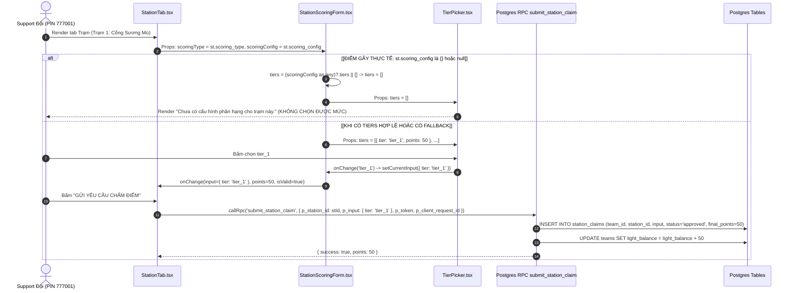
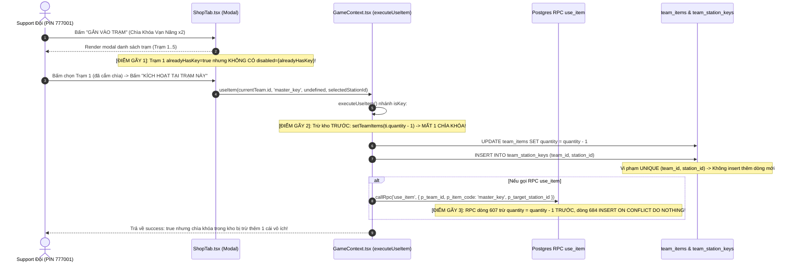
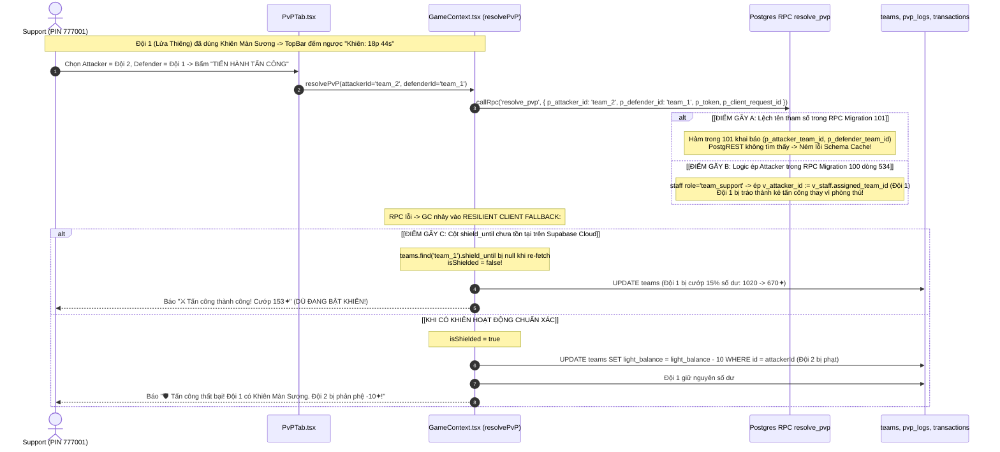

# TÀI LIỆU GỐC KIẾN TRÚC & TRÍCH XUẤT SOURCE CODE (ARCHITECTURE & CODE CONTEXT)
**Tệp:** `docs/v2/10-architecture-and-code-context.md`  
**Dự án:** Evermyst Command Center v2.0  
**Nguyên tắc:** ZERO-HALLUCINATION — Toàn bộ interface, state, đoạn code và tên biến được trích xuất 100% nguyên văn từ mã nguồn thực tế.

---

## PHẦN 1: TYPESCRIPT INTERFACES & REACT STATES THỰC TẾ

### 1. Interfaces Liên Quan Đến Trạm & Chấm Điểm (`Station`, `ScoringConfig`, `Tier`)

#### Trích từ [`src/lib/types.ts`](file:///c:/Users/ADMIN/Documents/ProPTIT/Ban%20SK/BIGGAME%20D26/src/lib/types.ts#L61-L76):
```ts
export type ScoringType = 'tier' | 'fixed' | 'time_attack';

export interface Station {
  id: string;
  name: string;
  description: string;
  order_index: number;
  is_active: boolean;
  scoring_type: ScoringType;
  scoring_config: Record<string, any>;
  min_score: number;
  max_score: number;
  allow_multiple_attempts: boolean;
  created_at: string;
  deleted_at?: string | null;
}
```

#### Trích từ [`src/scoring/types.ts`](file:///c:/Users/ADMIN/Documents/ProPTIT/Ban%20SK/BIGGAME%20D26/src/scoring/types.ts#L7-L53):
```ts
export type ScoringType = 'tier' | 'fixed' | 'time_attack';

export interface TierItem {
  tier: string;
  label?: string;
  points: number;
}

export interface TierScoringConfig {
  tiers: TierItem[];
}

export interface FixedScoringConfig {
  points?: number;
  options?: Array<{ id: string; label: string; points?: number }>;
}

export interface TimeAttackScoringConfig {
  base_points?: number;
  unit_points?: number;
  max_units?: number;
  unit_label?: string;
}

export type ScoringConfig = TierScoringConfig | FixedScoringConfig | TimeAttackScoringConfig | Record<string, any>;

export interface TierScoringInput {
  tier: string;
}

export interface FixedScoringInput {
  completed: boolean;
  selected_options?: string[];
}

export interface TimeAttackScoringInput {
  units: number;
}

export type ScoringInput = TierScoringInput | FixedScoringInput | TimeAttackScoringInput | Record<string, any>;

export interface ScoringPreviewResult {
  points: number;
  isValid: boolean;
  error?: string;
}
```

---

### 2. Interfaces & States Liên Quan Đến Đội, Kho Đồ, Khiên, Chìa Khóa

#### Trích từ [`src/lib/types.ts`](file:///c:/Users/ADMIN/Documents/ProPTIT/Ban%20SK/BIGGAME%20D26/src/lib/types.ts#L50-L59 và L119-L129):
```ts
export interface Team {
  id: string;
  name: string;
  qr_code: string;
  light_balance: number;
  shield_until: string | null;
  unlocked_stations: string[];
  is_active: boolean;
  created_at: string;
}

export interface TeamItem {
  id: string;
  team_id: string;
  item_id: string;
  item_code?: string;
  quantity: number;
  used_count: number;
  created_at: string;
  updated_at: string;
  item?: Item;
}
```

#### Khai báo `useState` thực tế trong [`src/contexts/GameContext.tsx`](file:///c:/Users/ADMIN/Documents/ProPTIT/Ban%20SK/BIGGAME%20D26/src/contexts/GameContext.tsx#L129-L148):
```ts
  // Game data state
  const [teams, setTeams] = useState<Team[]>([]);
  const [stations, setStations] = useState<Station[]>([]);
  const [hints, setHints] = useState<Hint[]>([]);
  const [teamHints, setTeamHints] = useState<TeamHint[]>([]);
  const [items, setItems] = useState<Item[]>([]);
  const [teamItems, setTeamItems] = useState<TeamItem[]>([]);
  const [teamStationKeys, setTeamStationKeys] = useState<Record<string, string[]>>(() => {
    try {
      const saved = localStorage.getItem('evermyst_team_station_keys');
      return saved ? JSON.parse(saved) : {};
    } catch {
      return {};
    }
  });
  const [transactions, setTransactions] = useState<Transaction[]>([]);
  const [pvpLogs, setPvpLogs] = useState<PvPLog[]>([]);
  const [config, setConfig] = useState<GameConfig>(DEFAULT_CONFIG);
  const [settingsRows, setSettingsRows] = useState<GameSetting[]>([]);
```

---

### 3. Cơ Chế Hàm `callRpc` (Gắn `p_token` & `p_client_request_id`)

#### Trích nguyên văn từ [`src/lib/rpc.ts`](file:///c:/Users/ADMIN/Documents/ProPTIT/Ban%20SK/BIGGAME%20D26/src/lib/rpc.ts#L80-L99):
```ts
  const token = localStorage.getItem(TOKEN_STORAGE_KEY) || '';

  const finalArgs: Record<string, any> = { ...args };

  // 1. Tự động gắn p_token nếu RPC yêu cầu và chưa được truyền tường minh
  if (!('p_token' in finalArgs) && rpcName !== 'staff_login') {
    finalArgs.p_token = token;
  }

  // 2. Tự động sinh hoặc giữ nguyên p_client_request_id cho RPC ghi
  const isMutation = options.isMutation ?? MUTATION_RPCS.has(rpcName);
  const needsIdempotency = IDEMPOTENT_MUTATIONS.has(rpcName);

  if (needsIdempotency && !finalArgs.p_client_request_id) {
    finalArgs.p_client_request_id = options.clientRequestId || generateClientRequestId();
  }

  try {
    const { data, error } = await supabase.rpc(rpcName, finalArgs);
```
*Lưu ý:* `callRpc` tự động tiêm `p_token: string` và `p_client_request_id: string` vào payload gửi tới Supabase PostgREST.

---

## PHẦN 2: MERMAID SEQUENCE DIAGRAMS (ĐÚNG TÊN HÀM & TÊN THAM SỐ THỰC TẾ)

### 1. Luồng 1: Load Cấu Hình Tier & Submit Điểm Trạm



---

### 2. Luồng 2: Cắm Chìa Khóa Vạn Năng



---

### 3. Luồng 3: Bật Khiên Màn Sương & Phân Xử PvP



---

## PHẦN 3: BẢN TRÍCH XUẤT CODE NGUYÊN VĂN (EXACT CODE SNIPPETS)

### 1. `src/components/scoring/StationScoringForm.tsx` (Dòng 36 đến 52)
```tsx
  // Khởi tạo state input dựa trên scoringType
  const [currentInput, setCurrentInput] = useState<ScoringInput>(() => {
    if (initialInput && Object.keys(initialInput).length > 0) {
      return initialInput;
    }
    if (scoringType === 'tier') {
      const tiers = (scoringConfig as any)?.tiers || [];
      return { tier: tiers[0]?.tier || '' };
    }
    if (scoringType === 'fixed') {
      return { completed: true, selected_options: [] };
    }
    if (scoringType === 'time_attack') {
      return { units: 1 };
    }
    return {};
  });
```

---

### 2. `src/components/support/StationTab.tsx` (Dòng 65 đến 97)
```tsx
  // Tải trạng thái các trạm của đội
  const fetchStationStatuses = useCallback(async () => {
    if (!selectedTeam) return;
    try {
      const res = await callRpc<any>('get_team_station_status');
      if (res.success && Array.isArray(res.stations)) {
        const enriched = res.stations.map((st: StationStatusItem) => ({
          ...st,
          has_key: st.has_key || teamKeys.includes(st.station_id),
        }));
        setStationStatuses(enriched);
      } else {
        // Fallback tự sinh từ danh sách stations và team
        const activeStations = stations.filter((s) => s.is_active);
        const mapped = activeStations.map((st) => ({
          station_id: st.id,
          station_name: st.name,
          order_index: st.order_index,
          scoring_type: st.scoring_type,
          scoring_config: st.scoring_config,
          allow_multiple_attempts: st.allow_multiple_attempts,
          has_key: teamKeys.includes(st.id) || false,
          active_claim: selectedTeam.unlocked_stations?.includes(st.id)
            ? { id: 'done', status: 'approved' as const, points: st.max_score, created_at: new Date().toISOString() }
            : null,
        }));
        setStationStatuses(mapped);
      }
    } catch {
      // ignore
    } finally {
      setIsLoading(false);
    }
  }, [selectedTeam, stations, teamKeys]);
```

---

### 3. `src/components/support/ShopTab.tsx`

#### A. Hàm `handleExecuteKey` (Dòng 200 đến 209):
```tsx
  const handleExecuteKey = async () => {
    if (!currentTeam || !selectedStationId || isProcessing) return;
    setIsProcessing(true);

    const res = await useItem(currentTeam.id, 'master_key', undefined, selectedStationId);
    if (res.success) {
      setIsKeyModalOpen(false);
    }
    setIsProcessing(false);
  };
```

#### B. Đoạn JSX render danh sách nút chọn trạm trong Modal cắm chìa khóa (Dòng 807 đến 835):
```tsx
              <div className="space-y-2 max-h-56 overflow-y-auto pr-1">
                {activeStations.map((st) => {
                  const alreadyHasKey = activeKeyStationIds.includes(st.id);
                  return (
                    <button
                      key={st.id}
                      onClick={() => setSelectedStationId(st.id)}
                      className={`w-full flex items-center justify-between p-3 rounded-xl border text-left transition-all ${
                        selectedStationId === st.id
                          ? 'bg-amber-500/15 border-amber-500 text-white font-bold'
                          : 'bg-evermyst-card border-evermyst-border text-evermyst-text-dim hover:border-evermyst-border-light'
                      }`}
                    >
                      <div className="flex items-center gap-2">
                        <span className="w-5 h-5 rounded-md bg-evermyst-surface text-amber-400 font-mono text-xs font-bold flex items-center justify-center">
                          {st.order_index}
                        </span>
                        <span className="text-xs truncate">{st.name}</span>
                      </div>

                      {alreadyHasKey && (
                        <span className="text-[10px] font-bold text-amber-400 flex items-center gap-0.5">
                          <CheckCircle2 className="w-3 h-3" /> Đã cắm
                        </span>
                      )}
                    </button>
                  );
                })}
              </div>
```

---

### 4. `src/components/support/KeyModal.tsx`

#### A. Hàm `handleConfirmKey` (Dòng 37 đến 63):
```tsx
  const handleConfirmKey = async () => {
    if (!selectedStationId) {
      setErrorMsg('Vui lòng chọn trạm cần gán chìa khóa cổ tích.');
      return;
    }

    setIsSubmitting(true);
    setErrorMsg(null);

    try {
      const res = await callRpc<any>('use_team_item', {
        p_item_id: itemId,
        p_target_station_id: selectedStationId,
      });

      if (res.success) {
        onSuccess();
        onClose();
      } else {
        setErrorMsg(res.error || res.message || 'Không thể kích hoạt chìa khóa.');
      }
    } catch (err: any) {
      setErrorMsg(err?.message || 'Lỗi mạng khi kết nối máy chủ.');
    } finally {
      setIsSubmitting(false);
    }
  };
```

#### B. Đoạn JSX render nút chọn trạm (Dòng 99 đến 141):
```tsx
            {activeStations.map((st) => {
              const isCleared = unlockedStationIds.includes(st.id);
              const isSelected = selectedStationId === st.id;

              return (
                <button
                  key={st.id}
                  type="button"
                  disabled={isCleared}
                  onClick={() => {
                    setSelectedStationId(st.id);
                    setErrorMsg(null);
                  }}
                  className={`w-full p-3 rounded-2xl border flex items-center justify-between text-left transition-all ${
                    isCleared
                      ? 'bg-evermyst-surface/40 border-evermyst-border/40 opacity-40 cursor-not-allowed'
                      : isSelected
                      ? 'bg-amber-500/15 border-amber-500 text-white shadow-md shadow-amber-500/10 ring-1 ring-amber-500'
                      : 'bg-evermyst-surface border-evermyst-border text-evermyst-text hover:border-evermyst-border-light'
                  }`}
                >
                  <div className="flex items-center gap-2.5 truncate">
                    <MapPin className="w-4 h-4 text-lumen shrink-0" />
                    <div className="truncate">
                      <div className="font-bold text-sm truncate">{st.name}</div>
                      <div className="text-[10px] text-evermyst-text-muted">
                        {st.scoring_type.toUpperCase()} • Tối đa {st.max_score}✦
                      </div>
                    </div>
                  </div>

                  {isCleared ? (
                    <span className="text-[10px] font-bold text-success px-2 py-0.5 rounded bg-success/15 shrink-0 flex items-center gap-1">
                      <CheckCircle className="w-3 h-3" /> Đã clear
                    </span>
                  ) : (
                    <span className="text-xs font-mono font-bold text-amber-400 shrink-0">
                      Chưa clear
                    </span>
                  )}
                </button>
              );
            })}
```

---

### 5. `src/contexts/GameContext.tsx`

#### A. Hàm `refreshAll` (Đoạn fetch `stations` và `teams`, Dòng 242 đến 268):
```tsx
      ] = await Promise.all([
        supabase.from('teams').select('*').order('light_balance', { ascending: false }),
        supabase.from('stations').select('*').order('order_index', { ascending: true }),
        supabase.from('hints').select('id, station_id, title, content, tier, order_index, is_active, created_at').order('order_index', { ascending: true }),
        supabase.from('team_hints').select('*'),
        supabase.from('items').select('*').order('price', { ascending: true }),
        supabase.from('team_items').select('*, item:items(*)'),
        supabase.from('transactions').select('*').order('created_at', { ascending: false }).limit(200),
        supabase.from('pvp_logs').select('*').order('created_at', { ascending: false }).limit(100),
        supabase.from('game_settings').select('*'),
        supabase.from('team_station_keys').select('*'),
      ]);

      if (teamsRes.data) setTeams(teamsRes.data);

      if (stationsRes.data) {
        // Deduplicate stations by order_index
        const uniqueStations: Station[] = [];
        const seenOrder = new Set<number>();
        stationsRes.data.forEach((st: Station) => {
          if (!seenOrder.has(st.order_index)) {
            seenOrder.add(st.order_index);
            uniqueStations.push(st);
          }
        });
        setStations(uniqueStations.length > 0 ? uniqueStations : stationsRes.data);
      }
```

#### B. Hàm `executeUseItem` (Nhánh `isShield` và `isKey`, Dòng 909 đến 936 và 967 đến 1010):
```tsx
      // 3. Side effects
      if (isShield) {
        const team = teams.find((t) => t.id === teamId);
        const currentShieldEnd = team?.shield_until ? new Date(team.shield_until).getTime() : 0;
        const now = Date.now();
        const baseTime = currentShieldEnd > now ? currentShieldEnd : now;
        const newShieldUntil = new Date(baseTime + 20 * 60 * 1000).toISOString();

        // Update Supabase teams table
        try {
          await supabase.from('teams').update({ shield_until: newShieldUntil }).eq('id', teamId);
        } catch (err) {
          console.error('Error updating shield_until:', err);
        }

        // Update local teams state immediately -> TopBar will count down right away!
        setTeams((prev) =>
          prev.map((t) => (t.id === teamId ? { ...t, shield_until: newShieldUntil } : t))
        );

        const msg = '🛡️ Đã kích hoạt Khiên Màn Sương! Đội được bảo vệ an toàn trong 20 phút.';
        addToast(msg, 'success');
        return {
          success: true,
          item_code: 'shield',
          shield_until: newShieldUntil,
          message: msg,
        };
      }
```
*(nhánh `isKey`)*:
```tsx
      if (isKey) {
        if (!targetStationId) {
          addToast('Vui lòng chọn trạm mục tiêu để cắm chìa khóa.', 'warning');
          return { success: false, error: 'Chưa chọn trạm mục tiêu' };
        }

        const station = stations.find((s) => s.id === targetStationId);
        const stationName = station?.name || 'Trạm mục tiêu';

        // Update teamStationKeys state & localStorage
        setTeamStationKeys((prev) => {
          const currentList = prev[teamId] || [];
          if (!currentList.includes(targetStationId)) {
            const updated = { ...prev, [teamId]: [...currentList, targetStationId] };
            try {
              localStorage.setItem('evermyst_team_station_keys', JSON.stringify(updated));
            } catch {
              // ignore
            }
            return updated;
          }
          return prev;
        });

        // Insert into Supabase team_station_keys table
        try {
          await supabase.from('team_station_keys').insert({
            team_id: teamId,
            station_id: targetStationId,
          });
        } catch {
          // ignore
        }

        const msg = `🗝️ Đã kích hoạt Chìa Khóa Vạn Năng tại ${stationName}!`;
        addToast(msg, 'success');
        return {
          success: true,
          item_code: 'master_key',
          station_id: targetStationId,
          station_name: stationName,
          message: msg,
        };
      }
```

#### C. Hàm `resolvePvP` (Nguyên văn toàn bộ hàm, Dòng 1028 đến 1120):
```tsx
  const resolvePvP = useCallback(
    async (attackerId: string, defenderId: string): Promise<PvPResponse> => {
      try {
        const res = await callRpc<any>('resolve_pvp', {
          p_attacker_id: attackerId,
          p_defender_id: defenderId,
        });

        if (res.success) {
          if (res.result === 'backlash') {
            addToast(res.message || 'Bị phản phệ bởi Khiên Màn Sương (-10 Lumen)!', 'warning');
          } else {
            addToast(res.message || 'Cướp điểm thành công!', 'success');
          }
          refreshAll();
          return res as PvPResponse;
        }
      } catch (e) {
        console.warn('RPC resolve_pvp failed, entering resilient fallback:', e);
      }

      // RESILIENT CLIENT FALLBACK:
      const attacker = teams.find((t) => t.id === attackerId);
      const defender = teams.find((t) => t.id === defenderId);
      if (!attacker || !defender) {
        addToast('Không tìm thấy thông tin một trong hai đội.', 'error');
        return { success: false, error: 'Đội không tồn tại' };
      }

      const isShielded = defender.shield_until ? new Date(defender.shield_until).getTime() > Date.now() : false;

      if (isShielded) {
        // Backlash: -10 Lumen attacker
        const backlash = 10;
        const newAttackerBalance = Math.max(0, attacker.light_balance - backlash);

        try {
          await supabase.from('teams').update({ light_balance: newAttackerBalance }).eq('id', attackerId);
        } catch {
          // ignore
        }

        setTeams((prev) =>
          prev.map((t) => (t.id === attackerId ? { ...t, light_balance: newAttackerBalance } : t))
        );

        const msg = `🛡️ Tấn công thất bại! ${defender.name} đang bật Khiên Màn Sương. ${attacker.name} bị phạt phản phệ -${backlash}✦ Lumen!`;
        addToast(msg, 'warning');

        return {
          success: true,
          result: 'backlash',
          message: msg,
          stolen_amount: 0,
          attacker_balance: newAttackerBalance,
          defender_balance: defender.light_balance,
        };
      }

      // Attack win: 15% (min 5)
      const stealAmount = Math.max(5, Math.min(defender.light_balance, Math.round(defender.light_balance * 0.15)));
      const newDefenderBalance = Math.max(0, defender.light_balance - stealAmount);
      const newAttackerBalance = attacker.light_balance + stealAmount;

      try {
        await supabase.from('teams').update({ light_balance: newDefenderBalance }).eq('id', defenderId);
        await supabase.from('teams').update({ light_balance: newAttackerBalance }).eq('id', attackerId);
      } catch {
        // ignore
      }

      setTeams((prev) =>
        prev.map((t) => {
          if (t.id === attackerId) return { ...t, light_balance: newAttackerBalance };
          if (t.id === defenderId) return { ...t, light_balance: newDefenderBalance };
          return t;
        })
      );

      const msg = `⚔️ Tấn công thành công! ${attacker.name} đã cướp +${stealAmount}✦ Lumen từ ${defender.name}!`;
      addToast(msg, 'success');

      return {
        success: true,
        result: 'success',
        amount_stolen: stealAmount,
        attacker_balance: newAttackerBalance,
        defender_balance: newDefenderBalance,
        message: msg,
      };
    },
    [teams, addToast, refreshAll]
  );
```

---

### 6. `src/components/support/PvPTab.tsx`

#### A. Hàm `handleFight` (Dòng 149 đến 157):
```tsx
  const handleFight = async () => {
    if (!canFight) return;
    setIsProcessing(true);
    setLastResult(null);

    const res = await resolvePvP(attackerId, defenderId);
    setLastResult(res);
    setIsProcessing(false);
  };
```

#### B. Khu vực hiển thị thông tin Đội Phòng Thủ (Dòng 193 đến 219):
```tsx
        <TeamSelectBox
          label="Đội Phòng Thủ (Bị Quét)"
          value={defenderId}
          onChange={setDefenderId}
          showList={showDefenderList}
          setShowList={setShowDefenderList}
          excludeId={attackerId}
          teams={activeTeams}
          icon={<Shield className="w-3.5 h-3.5 text-props" />}
        />
      </div>

      {/* Warnings: Defender Shield Active */}
      {defender && defenderShield.active && (
        <div className="p-3.5 rounded-2xl bg-props/15 border border-props/40 space-y-1.5 animate-fadeIn">
          <div className="flex items-center gap-2 text-xs font-bold text-props">
            <ShieldAlert className="w-4 h-4 shrink-0" />
            <span>CẢNH BÁO: Đội phòng thủ đang có Khiên Màn Sương!</span>
          </div>
          <p className="text-xs text-props-light leading-relaxed">
            Nếu tấn công bây giờ, {attacker?.name || 'Đội tấn công'} sẽ bị <strong>phản phệ</strong> và bị phạt -{config.pvp_backlash_amount} Lumen!
          </p>
          <div className="text-[11px] font-mono text-props font-bold pt-0.5">
            {defenderShield.label}
          </div>
        </div>
      )}
```

---

### 7. SQL Migrations

#### A. `use_item` trong `supabase/migrations/101_shop_inventory_rpc_fix.sql` (Dòng 564 đến 612 và 668 đến 700):
```sql
CREATE OR REPLACE FUNCTION use_item(
    p_team_id           UUID,
    p_item_code         TEXT,
    p_target_team_id    UUID DEFAULT NULL,
    p_target_station_id UUID DEFAULT NULL
)
RETURNS JSONB
LANGUAGE plpgsql
SECURITY DEFINER
AS $$
DECLARE
    v_item              RECORD;
    v_inventory         RECORD;
    v_target_team       RECORD;
    v_target_station    RECORD;
    v_new_shield_until  TIMESTAMPTZ;
    v_has_active_shield BOOLEAN;
BEGIN
    -- 1. Tìm item
    SELECT * INTO v_item 
    FROM items 
    WHERE (item_code = p_item_code OR id::text = p_item_code OR effect_type = p_item_code)
    LIMIT 1;

    IF v_item.id IS NULL THEN
        RETURN jsonb_build_object('success', false, 'code', 'ITEM_NOT_FOUND', 'error', 'Không tìm thấy đạo cụ.');
    END IF;

    -- 2. Kiểm tra số lượng trong kho
    SELECT * INTO v_inventory 
    FROM team_items 
    WHERE team_id = p_team_id AND item_id = v_item.id AND quantity > 0
    FOR UPDATE;

    IF v_inventory.id IS NULL OR v_inventory.quantity <= 0 THEN
        RETURN jsonb_build_object(
            'success', false, 
            'code', 'ITEM_NOT_OWNED', 
            'error', 'Đội không còn ' || v_item.name || ' trong kho đồ!'
        );
    END IF;

    -- 3. Trừ 1 số lượng trong kho
    UPDATE team_items
    SET quantity = quantity - 1,
        used_count = used_count + 1,
        updated_at = now()
    WHERE id = v_inventory.id;
```
*(Đoạn xử lý nhánh `key` dòng 668-700)*:
```sql
    ELSIF v_item.effect_type IN ('key', 'master_key') THEN
        -- Gắn Chìa Khóa Vạn Năng vào trạm mục tiêu
        IF p_target_station_id IS NULL THEN
            UPDATE team_items SET quantity = quantity + 1 WHERE id = v_inventory.id;
            RETURN jsonb_build_object('success', false, 'code', 'STATION_REQUIRED', 'error', 'Vui lòng chọn trạm mục tiêu để cắm Chìa Khóa Vạn Năng.');
        END IF;

        SELECT * INTO v_target_station FROM stations WHERE id = p_target_station_id;
        IF v_target_station.id IS NULL THEN
            UPDATE team_items SET quantity = quantity + 1 WHERE id = v_inventory.id;
            RETURN jsonb_build_object('success', false, 'code', 'STATION_NOT_FOUND', 'error', 'Trạm mục tiêu không tồn tại.');
        END IF;

        -- Ghi vào team_station_keys
        INSERT INTO team_station_keys (team_id, station_id)
        VALUES (p_team_id, p_target_station_id)
        ON CONFLICT (team_id, station_id) DO NOTHING;

        INSERT INTO transactions (team_id, amount, type, description, created_by, status)
        VALUES (
            p_team_id, 0, 'buy_item',
            'Kích hoạt Chìa Khóa Vạn Năng tại ' || v_target_station.name,
            'Support', 'approved'
        );

        RETURN jsonb_build_object(
            'success', true,
            'item_code', 'master_key',
            'station_id', p_target_station_id,
            'station_name', v_target_station.name,
            'message', '🗝️ Đã kích hoạt Chìa Khóa Vạn Năng tại ' || v_target_station.name || '!'
        );
```

#### B. `resolve_pvp` trong `supabase/migrations/100_economy_engine.sql` (Dòng 529 đến 544):
```sql
    -- 1. Xác thực & Attacker lấy từ token (riêng admin có thể chỉ định)
    v_staff := _require_staff(p_token, ARRAY['team_support', 'admin']);
    IF v_staff.role = 'admin' AND p_attacker_id IS NOT NULL THEN
        v_attacker_id := p_attacker_id;
    ELSE
        v_attacker_id := v_staff.assigned_team_id;
    END IF;

    IF v_attacker_id IS NULL THEN
        RAISE EXCEPTION 'FORBIDDEN_TEAM: Chưa phân công đội.' USING ERRCODE = 'P0005';
    END IF;

    -- Chặn tự tấn công
    IF v_attacker_id = p_defender_id THEN
        RETURN jsonb_build_object('success', false, 'code', 'PVP_SAME_TEAM', 'error', 'Không thể tự tấn công chính đội của mình!');
    END IF;
```

#### C. `resolve_pvp` trong `supabase/migrations/101_shop_inventory_rpc_fix.sql` (Dòng 753 đến 798 và 846 đến 859):
```sql
CREATE OR REPLACE FUNCTION resolve_pvp(
    p_attacker_id UUID,
    p_defender_id UUID
)
RETURNS JSONB
LANGUAGE plpgsql
SECURITY DEFINER
AS $$
DECLARE
    v_attacker RECORD;
    v_defender RECORD;
    v_is_shielded BOOLEAN;
    v_steal_amount INT;
    v_backlash_amount INT := 10;
BEGIN
    IF p_attacker_id = p_defender_id THEN
        RETURN jsonb_build_object('success', false, 'error', 'Không thể tấn công chính đội mình.');
    END IF;

    -- Deadlock-free locking: khóa dòng theo thứ tự UUID
    IF p_attacker_id < p_defender_id THEN
        SELECT * INTO v_attacker FROM teams WHERE id = p_attacker_id FOR UPDATE;
        SELECT * INTO v_defender FROM teams WHERE id = p_defender_id FOR UPDATE;
    ELSE
        SELECT * INTO v_defender FROM teams WHERE id = p_defender_id FOR UPDATE;
        SELECT * INTO v_attacker FROM teams WHERE id = p_attacker_id FOR UPDATE;
    END IF;

    IF v_attacker.id IS NULL OR v_defender.id IS NULL THEN
        RETURN jsonb_build_object('success', false, 'error', 'Không tìm thấy thông tin một trong hai đội.');
    END IF;

    -- Kiểm tra Khiên bảo vệ của bên phòng thủ
    v_is_shielded := (v_defender.shield_until IS NOT NULL AND v_defender.shield_until > now());

    IF v_is_shielded THEN
        -- Bị phản phệ: kẻ tấn công bị trừ 10 Lumen, phòng thủ được an toàn
        UPDATE teams 
        SET light_balance = GREATEST(0, light_balance - v_backlash_amount) 
        WHERE id = p_attacker_id;

        INSERT INTO transactions (team_id, amount, type, description, created_by, status)
        VALUES (
            p_attacker_id, -v_backlash_amount, 'pvp_backlash',
            'Phản phệ PvP khi tấn công ' || v_defender.name || ' đang có Khiên Màn Sương',
            'Support', 'approved'
        );
```
*(Overload 4 tham số dòng 846-859)*:
```sql
-- Overload resolve_pvp hỗ trợ 4 tham số
CREATE OR REPLACE FUNCTION resolve_pvp(
    p_token TEXT,
    p_client_request_id TEXT,
    p_attacker_team_id UUID,
    p_defender_team_id UUID
)
RETURNS JSONB
LANGUAGE plpgsql
SECURITY DEFINER
AS $$
BEGIN
    RETURN resolve_pvp(p_attacker_team_id, p_defender_team_id);
END;
$$;
```

#### D. `admin_upsert_station` trong `supabase/migrations/102_admin_stations_items_pvp_fix.sql` (Dòng 147 đến 180):
```sql
CREATE OR REPLACE FUNCTION public.admin_upsert_station(
    p_allow_multiple_attempts   BOOLEAN DEFAULT false,
    p_description               TEXT DEFAULT '',
    p_id                        UUID DEFAULT NULL,
    p_is_active                 BOOLEAN DEFAULT true,
    p_max_score                 INT DEFAULT 100,
    p_min_score                 INT DEFAULT 0,
    p_name                      TEXT DEFAULT NULL,
    p_order_index               INT DEFAULT 0,
    p_scoring_config            JSONB DEFAULT '{}'::jsonb,
    p_scoring_type              TEXT DEFAULT 'tier',
    p_token                     TEXT DEFAULT NULL
)
RETURNS JSONB
LANGUAGE plpgsql
SECURITY DEFINER
AS $$
DECLARE
    v_station_id    UUID;
    v_station       stations%ROWTYPE;
    v_before        JSONB;
    v_after         JSONB;
    v_action        TEXT;
BEGIN
    IF p_name IS NULL OR trim(p_name) = '' THEN
        RETURN jsonb_build_object('success', false, 'code', 'NAME_REQUIRED', 'error', 'Tên trạm không được để trống.');
    END IF;

    IF p_min_score < 0 OR p_max_score < p_min_score THEN
        RETURN jsonb_build_object('success', false, 'code', 'INVALID_SCORE_RANGE', 'error', 'Khoảng điểm không hợp lệ (min >= 0 và min <= max).');
    END IF;

    IF p_scoring_type NOT IN ('tier', 'fixed', 'time_attack') THEN
        RETURN jsonb_build_object('success', false, 'code', 'INVALID_SCORING_TYPE', 'error', 'Mô hình tính điểm không hợp lệ.');
    END IF;
```
